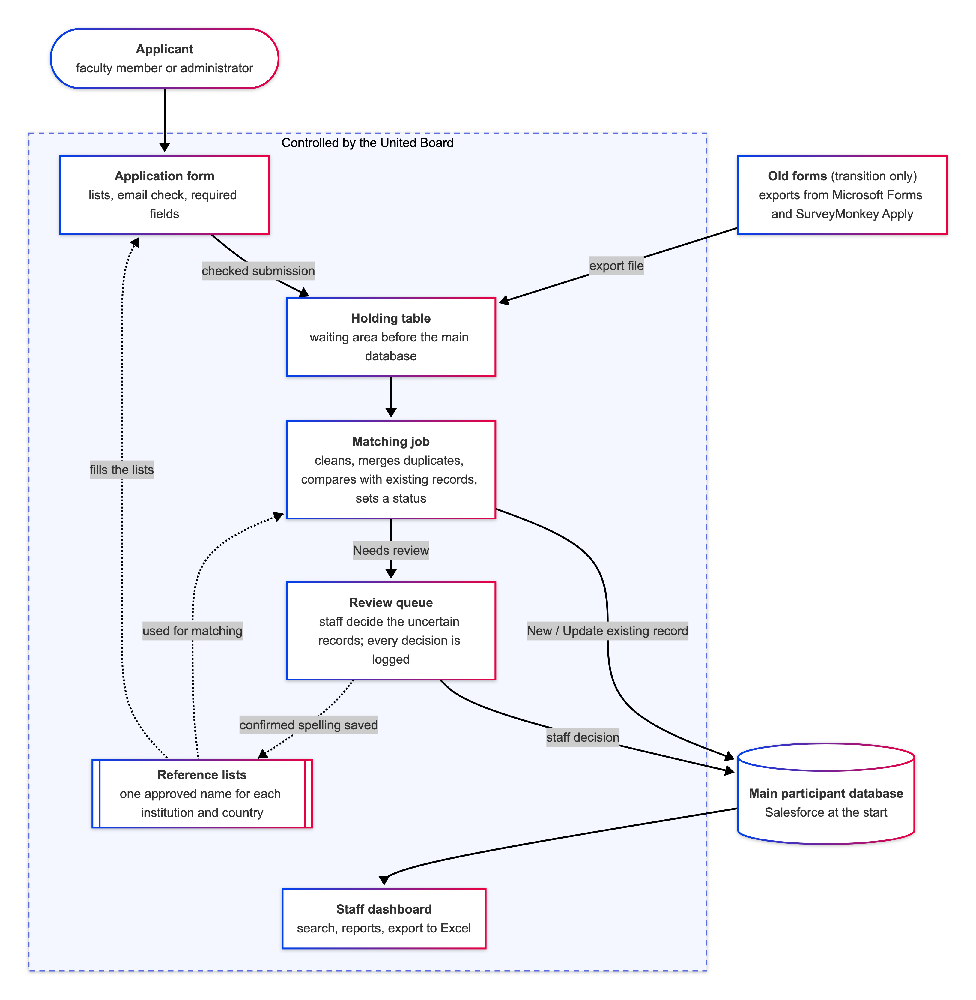

# United Board assessment: Part B

Cleans the 12 workshop applications in `data/applications.csv`, compares them with the 4 database records in `data/existing_records.csv`, and writes the results to `outputs/`.

```
uv run python -m united_board_accessment.pipeline
```

## Steps

All logic is in `src/united_board_accessment/pipeline.py`. The steps run in this order:

**Read -> Normalise -> Dedupe -> Validate -> Match -> Classify -> Apply field rules**

### 1. Read

Both CSVs are read with blanks kept as empty text. The raw files are never changed.

### 2. Normalise (both tables)

| Field       | Rule                                                                 |
| ----------- | -------------------------------------------------------------------- |
| All text    | Trim, collapse repeated spaces                                       |
| Name        | Title Case, only if written all lower-case or all upper-case         |
| Email       | Lower-case                                                           |
| Institution | Looked up in the reference list and its aliases; not found = unknown |
| Country     | Looked up as a code, then as a name; not found = unknown             |
| Date        | Must be `05 Jan 2027` format; written out as `2027-01-05`            |

> [!NOTE]
>
> - Lookups compare a key: lower-case, with spaces and punctuation turned into `_`.
> - There is no fuzzy matching.
> - The reference lists are in `reference_data.py`.

### 3. Dedupe within the batch

- Same email = same person.
- The latest submission wins. Its blank fields are filled from the same person's earlier submissions in the batch.
- A row with an invalid date or a blank email is never merged.

### 4. Validate (on the merged records)

- Email must look like `name@domain.tld`.
- Required: full name, email, institution, country, position, endorsement.
- Institution and country must be known, meaning listed in `reference_data.py`.

### 5. Match against the database

Each person is compared with the database records. The rules are tried in order and stop at the first one that is true.

| Rule | Same as a database record | Meaning                                         | In this data   |
| ---- | ------------------------- | ----------------------------------------------- | -------------- |
| 1    | Email                     | Same person                                     | Rafael         |
| 2    | Name, institution, country | Same person with a new email                   | Kavitha, Tiur  |
| 3    | Name only                 | Maybe the same person. Not treated as a match   | Marisol        |
| None | Nothing                   | Not in the database                             | Everyone else  |

### 6. Classify

A record gets the first status that applies.

1. **Needs review**, if any of these is true:
   - invalid email
   - missing required field
   - unknown institution or country
   - invalid date
   - name-only match
   - email match where institution or country differs
   - endorsement = No
2. **Update existing record**, if matched by rule 1 or 2.
3. **New**, otherwise.

> [!NOTE]
> Endorsement = No goes to review because eligibility is a staff decision. This is one flag, `ENDORSEMENT_NO_NEEDS_REVIEW`.

### 7. Apply field rules

- **Update existing record**
  - Name, institution, country: database value kept.
  - Email: incoming value replaces the database value.
  - Position, endorsement: taken from the application.
- **Needs review**: nothing is changed. The applicant's cleaned values are shown.
- **New**: the applicant's cleaned values.

> [!NOTE]
> The pipeline never writes to the database. It only produces the two files below; staff apply the New and Update rows when they import.

## Outputs

**`import_ready_list.csv`**: one row per person (11), with the cleaned values and a `status`. `submission_ids` links each row to the issues log.

**`issues_log.csv`**: one row per issue (19), for every record changed, excluded or flagged.

| Column      | Meaning                                                    |
| ----------- | ---------------------------------------------------------- |
| `issue`     | Short label, e.g. `Country code`, `Invalid email`          |
| `original`  | Value in the database, when a database record was compared |
| `incoming`  | Value the applicant submitted                              |
| `resolved`  | Value used. Blank = still open                             |
| `action`    | What was done                                              |
| `follow_up` | Next step, on Needs review rows only                       |

## Result

| Status                 | People |
| ---------------------- | ------ |
| New                    | 3      |
| Update existing record | 3      |
| Needs review           | 5      |

## Proposed workflow (Part A)

This pipeline is a working version of the matching job in the workflow proposed in Part A.


